## 🧠 About me

I'm an **AI Engineer** with **2+ years** of experience building production **Generative AI** and **Agentic AI** systems. I've shipped **3+ production AI products** in contract automation and fintech.

- 🤖 **Now:** AI Engineer at **MAVDERO**, building agentic pipelines that turn **500+ contracts a day** into structured data.
- 🧩 **Focus:** LLM systems, agentic workflows (LangChain, LangGraph), and intelligent document processing (OCR + LLMs).
- ⚡ **Backend:** Python, FastAPI, async microservices, Pydantic, Celery, Redis.
- ☁️ **Cloud:** Azure Functions, Cosmos DB, AWS EC2, Docker and GitHub Actions CI/CD.
- 🎓 **Education:** B.Sc. Statistics, Loyola College, Chennai.
- 📍 **Location:** Chennai, India. Open to conversations about GenAI and production ML.

## ⚙️ What I build

## 🛠️ Tech stack

  

## 💼 Experience

<b>AI Engineer · MAVDERO</b> · Remote · Jul 2025 – Present

 

- Architected an **Agentic AI contract-processing system** (LangChain, LangGraph). It ingests **300–500+ contracts/day** from Google Drive and extracts 50+ attributes into MongoDB via OCR + LLMs, cutting manual review time by **60%**.
- Designed **multi-model routing across 3+ LLMs**, with document classification, Pydantic validation of 40+ fields, confidence thresholds and automated fallback. This raised extraction accuracy to **92%+**.
- Scaled **5+ async FastAPI microservices** with parallel batch processing, doubling throughput while keeping average latency **under 300 ms**.
- Hardened pipelines with exponential-backoff retries, circuit breakers, structured logging and audit trails, cutting failure rates by **35%** and sustaining **99%+ job completion**.
- Built Azure Functions workflows that sync Cosmos DB change-feed data to PostgreSQL, reducing cross-system data latency by **35%**.
- Owned backend architecture for 3+ client projects, mentored 3+ junior engineers, and demoed to leadership every sprint.

<b>Full Stack AI Developer · Theta Treats (AdaptFin)</b> · Remote · Jan 2025 – Jun 2025

 

- Built an NLP **financial-news classifier with XGBoost** (F1 **0.85+**) that outperformed 3+ other ML and LLM models.
- Developed a containerized analytics platform (React, Flask, MongoDB, Docker) on AWS EC2 for 100+ concurrent simulated users, cutting portfolio analysis time by **50%**.
- Introduced Celery + Redis task queues, improving throughput and reliability by **25%**.
- Automated Docker builds and EC2 deployments with **GitHub Actions CI/CD**, giving zero-downtime releases.

<b>Data Science Intern · Innomatics Research Labs</b> · Remote · Feb 2023 – Mar 2023

 

- Created 3+ analytical dashboards with Pandas, Matplotlib, Plotly and Streamlit, improving reporting efficiency by **20%**.
- Delivered a Streamlit app with filterable EDA dashboards for the Iris (150 rows) and Titanic (418 rows) datasets.

## 🚀 Featured projects

| Project | What it is | Stack |
|---|---|---|
| 🌸 **[Iris & Titanic DS App](https://github.com/Lawrancepious/ds_proj)** · [**live demo**](https://lawrancepious-ds-proj-app-uiywhr.streamlit.app/) | Deployed 5-page ML app. It benchmarks 5 classifiers with 5-fold cross-validation (**96% accuracy**), engineers 7 features, and includes a **Gemini chat** with streaming and model fallback | Streamlit · scikit-learn · Plotly · Gemini |
| 📦 **[parcelpilot-agent](https://github.com/Lawrancepious/parcelpilot-agent)** | AI support agent for a B2B logistics platform: customer and staff personas, role-scoped tools, a human confirmation gate on every state-changing action, and proactive issue detection | Python · LLM agents |
| 🎟️ **[DYLA_THP](https://github.com/Lawrancepious/DYLA_THP)** | *Ticket Stampede*: a service that sells exactly N tickets to a crowd arriving all at once, plus a load client built to break it | Python · PostgreSQL · concurrency |
| 🧑‍🏫 **[dumroo-admin-panel](https://github.com/Lawrancepious/dumroo-admin-panel)** | Natural-language querying over student data with role-based access control | Python · LLMs |
| 🔤 **[webapp_ocr](https://github.com/Lawrancepious/webapp_ocr)** | Web app that extracts Hindi and English text from images | Streamlit · Tesseract OCR |
| 🩺 **Diabetes Risk Factor Analysis** | Regression and statistical modelling on 700+ patient records to find predictive health indicators | Python · Pandas · Regression |

## 📊 GitHub stats

 

<picture>
  <source media="(prefers-color-scheme: dark)" srcset="https://raw.githubusercontent.com/Lawrancepious/Lawrancepious/output/github-snake-dark.svg">
  
</picture>

**Open to conversations about GenAI, agents and production ML. [Let's connect](https://www.linkedin.com/in/lawrance-pious/)!**

